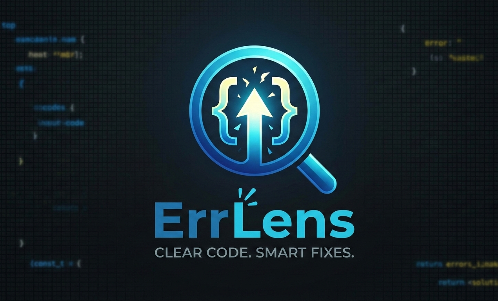
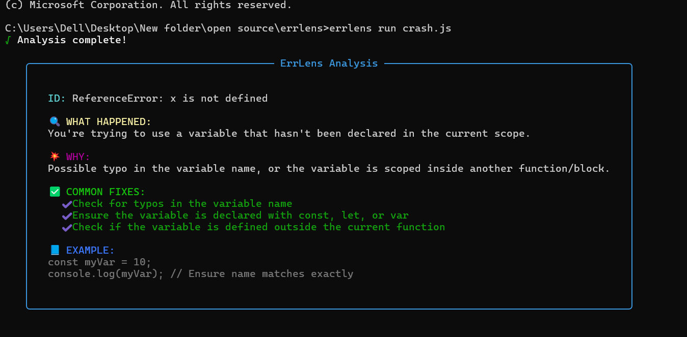
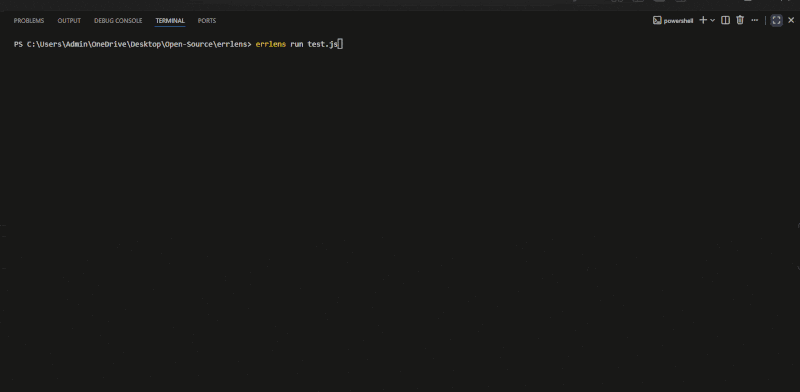
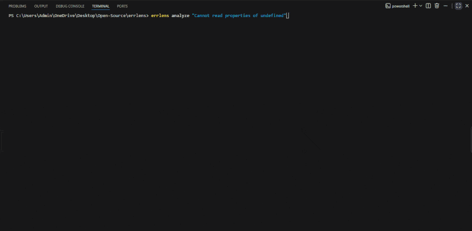

# ErrLens 🔍  
> **Translate cryptic JavaScript errors into human-readable solutions instantly.**

<p align="center">
  
</p>
</br>
</br>

<p align="center">
  <!-- GitHub Badges -->
  
  
  
  
  
  
  <!-- npm Badges -->
  <br>
  
  
  
  
</p>
**ErrLens** is a professional-grade CLI utility designed to eliminate developer frustration. It intercepts Node.js crashes, analyzes stack traces, and delivers plain-English explanations with actionable fixes—directly in your terminal.

---
</br>
</br>
</br>
<p align="center">
  
</p>
</br>
</br>

---

## 🎬 Live Demo

**Automatic Error Monitoring (`errlens run test.js`):**



**Manual Error Analysis (`errlens analyze "..."`):**



---

## 🌟 Key Features

- 🚀 **Instant Diagnostics** – No more context-switching to Google or StackOverflow.  
- 🔄 **Live Monitoring** – Catch errors in real-time using the `errlens run` command.  
- 🧠 **Fuzzy Logic Engine** – Matches messy stack traces and typos using `Fuse.js`.  
- 🎨 **Beautiful UI** – High-visibility terminal output powered by `boxen` and `chalk`.  
- 🎭 **Color Themes** – 5 built-in themes (`default`, `minimal`, `high-contrast`, `dracula`, `monokai`).  
- 🔍 **Verbose Mode** – Extra diagnostic details with `--verbose` for debugging custom patterns.  
- 📍 **Stack Trace Parsing** – Extract file/line/column from stack traces, with source snippets via `--context`.  
- 🤖 **CI/CD Ready** – Export raw data via `--json` for automated error reporting.  

---

## 📦 Installation

Install globally via npm to use the `errlens` command anywhere in your terminal:

```bash
npm install -g errlens
```

---

## ⚡ Quick Start
```bash
# Analyze an error message
errlens analyze "TypeError: Cannot read property 'name' of undefined"

# Run a script with error monitoring
errlens run your-script.js

# Get JSON output for CI/CD pipelines
errlens analyze "is not a function" --json

# Analyze an error in Hindi
errlens analyze "Cannot read properties of undefined" --lang hi

# Run a script with output in Spanish
errlens run app.js --lang es

# Use a color theme
errlens analyze "is not a function" --theme dracula

# Show verbose diagnostic info
errlens analyze "Cannot read properties of undefined" --verbose

# Show the source location and context from a stack trace
errlens analyze "TypeError: arr is not a function
  at handleData (src/index.ts:12:5)
  at main (src/index.ts:20:3)" --context

# Print stack-trace locations to JSON
errlens analyze "TypeError: arr is not a function
  at handleData (src/index.ts:12:5)" --json
```

---

## 🛠 Usage

### Available Commands

```bash
errlens run <file> [options]              # Run a script and analyze any crashes
errlens analyze <error> [options]         # Analyze a specific error message
errlens --version                         # Show version information
errlens --help                            # Show help
```

### Options

| Flag | Description |
|------|-------------|
| `--json` | Output raw JSON (no colors, no boxes) — perfect for CI/CD pipelines |
| `--theme <name>` | Pick a color theme (see the Color Themes section below) |
| `--verbose` | Show extra diagnostic info for each matched error |
| `--context` | Show a source snippet around the error location parsed from the stack trace |
| `--lang <code>` | Output language (e.g. `hi`, `es`, `fr`) — available on `run` and `analyze` |

### 1️⃣ Automatic Monitoring (The "Pro" Way)

Run your script through ErrLens. If it crashes, ErrLens intercepts the error and explains the fix before the process exits.

```bash
errlens run your-app.js
```

---

### 2️⃣ Manual Analysis

Found a weird error in your logs? Just paste the message:

```bash
errlens analyze "TypeError: Cannot read properties of undefined"
```

---

### 3️⃣ Pipeline Integration

Get machine-readable results for your own tooling or automated reports:

```bash
errlens analyze "is not a function" --json
```

Run a script and write the JSON report directly to a file in CI:

```bash
errlens run test.js --json > ci-report.json
```

In `--json` mode, ErrLens prints only JSON (no spinner, colors, or terminal boxes).

Example response from `run`:

```json
{
  "code": 0,
  "count": 0,
  "matches": [],
  "locations": []
}
```

Example response from `analyze <errorString>` (match found):

```json
{
  "code": 1,
  "count": 1,
  "matches": [
    {
      "name": "TypeError: Cannot read properties of undefined",
      "match": "Cannot read properties of undefined",
      "explanation": "You are trying to access a property on a variable that is currently empty.",
      "why": "The variable wasn't initialized, or an API call hasn't finished yet.",
      "fixes": [
        "Use optional chaining: user?.name",
        "Set a default value: data || []"
      ],
      "example": "const name = user?.name || 'Guest';"
    }
  ],
  "locations": [
    {
      "function": "readFoo",
      "file": "/home/user/app/src/index.js",
      "line": 12,
      "column": 5
    }
  ]
}
```

`locations` is an array of stack frames parsed from the error. When no stack trace is present, it is an empty array.

#### Stack Trace Context

When the error string contains a Node-style stack trace, ErrLens extracts the frame details (function name, file, line, column) automatically. Use `--context` to print a 5-line snippet around the first application frame:

```bash
errlens analyze "TypeError: arr.join is not a function
  at handleData (src/index.ts:12:5)
  at main (src/index.ts:20:3)" --context
```

```text
📍 LOCATION: handleData (src/index.ts:12:5)
📍 CONTEXT: src/index.ts:12
   10  const raw = fetchRows();
   11  const rows = raw.map(normalize);
   12 > const output = rows.join(',');
   13  return output;
   14  }
```

Internal frames (`node:internal/...`, `at <anonymous>`) are skipped when choosing the context location. Source snippets are only read from regular files inside the current working directory: `file://` locations are decoded, but paths outside the project root, symlink escapes, non-regular files, and files over 256 KiB are rejected and no snippet is shown.

Exit codes (useful for CI):

- `run <file>` exits with the child process exit code.
- `analyze <errorString>` exits with `1` when matches are found (intentional, so CI can fail when known errors are detected), otherwise `0`.

This follows Unix conventions where `0` means success and non-zero means failure. If you prefer success-on-detection in CI, invert the check in your pipeline logic (for example, treat exit code `1` from `analyze <errorString>` as a pass condition).

---

### 4️⃣ Color Themes

ErrLens ships with several built-in color themes. Use the `--theme` flag to switch between them:

```bash
errlens analyze "TypeError: Cannot read properties of undefined" --theme dracula
errlens run app.js --theme high-contrast
errlens analyze "is not a function" --theme monokai
```

#### Available Themes

| Theme | Description |
|-------|-------------|
| `default` | Cyan-bordered, colorful theme (the classic ErrLens look) |
| `minimal` | Grayscale — clean, distraction-free output |
| `high-contrast` | Bright colors on dark terminals for accessibility |
| `dracula` | Magenta/pink palette inspired by the Dracula color scheme |
| `monokai` | Yellow/green palette inspired by Monokai |

> **Tip:** Combine `--theme` with `--verbose` for the most detailed output:
> ```bash
> errlens analyze "Cannot read properties of undefined" --theme dracula --verbose
> ```

When using `--json`, themes are ignored — you always get clean machine-readable output.

#### Runtime Injection Themes

When using `errlens/injector` or `errlens/auto` in your own code, set themes via environment variables:

```bash
ERRLENS_THEME=monokai ERRLENS_VERBOSE=1 node app.js
```

---

### 5️⃣ Verbose Mode

Add `--verbose` to see extra diagnostic details alongside each error match:

```bash
errlens analyze "Cannot read properties of undefined" --verbose
```

Verbose output adds:
- **MATCH:** the exact substring that triggered the database lookup
- **LENGTH:** character count of the match phrase
- **KEY:** the internal database key used

This is useful when debugging custom error patterns or contributing new entries to the database.

---

### 6️⃣ Multilingual Support

ErrLens supports error explanations in multiple languages using the `--lang` flag.

**Default behavior:** English (`en`) is used when `--lang` is not specified.
```bash
# Run a file and get explanation in Hindi
errlens run app.js --lang hi

# Analyze an error string in Spanish
errlens analyze "Cannot read properties of undefined" --lang es

# Run a file and get explanation in Japanese
errlens run app.js --lang ja
```

#### 🌍 Supported Languages

| Language   | Code |
|------------|------|
| English    | `en` |
| Hindi      | `hi` |
| Spanish    | `es` |
| French     | `fr` |
| German     | `de` |
| Chinese    | `zh` |
| Japanese   | `ja` |
| Portuguese | `pt` |

> 💡 **Tip:** Combine with `--json` for multilingual CI/CD pipeline output:
> ```bash
> errlens analyze "is not a function" --lang fr --json
---

## 🧠 System Architecture

ErrLens operates on a three-stage intelligent pipeline to turn confusion into clarity:

| Phase          | Component       | Description |
|---------------|----------------|-------------|
| Interception  | `auto.js`      | Hooks into the `uncaughtException` event via a preload script. |
| Matching      | `matcher.js`   | Uses fuzzy search against `database.json` to find the root cause. |
| Formatting    | `formatter.js` | Wraps the diagnosis in a clean, color-coded terminal interface. |

---

## 📁 Project Structure

```
errlens/
├── bin/index.js       # CLI Entry point & Command routing
├── lib/
│   ├── matcher.js     # Fuzzy search & Logic engine
│   ├── formatter.js   # UI & Terminal styling
│   ├── themes.js      # Color theme definitions & resolver
│   ├── auto.js        # Automation & Error interception
│   ├── injector.js    # Runtime injection with theme support
│   └── database.json  # The "Knowledge Base" (Dictionary)
├── package.json       # Dependencies & Metadata
└── README.md          # Documentation
```

---

## 🤝 Contributing

We are building the world's most comprehensive dictionary of JavaScript errors, and we need your help!

1. Fork the repository.  
2. Add a new error entry to `lib/database.json`.  
3. Submit a Pull Request.  

💡 **Tip:** Every error you add helps another developer save valuable time. Join the mission!

---

## 📝 License

Distributed under the MIT License. See `LICENSE` for more information.

---

<p align="center">
  Built with ❤️ by <b>BeyteFlow</b><br>
  <i>Making the terminal a friendlier place, one error at a time.</i>
</p>
